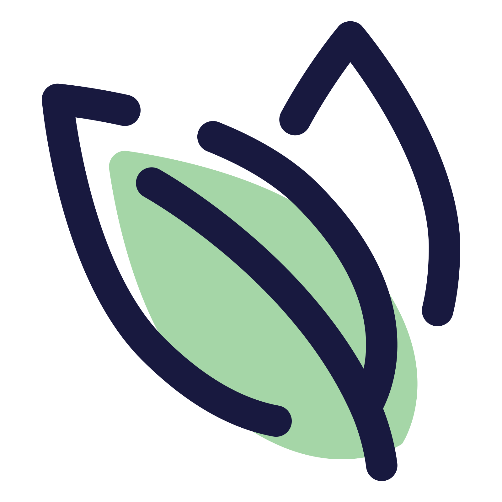
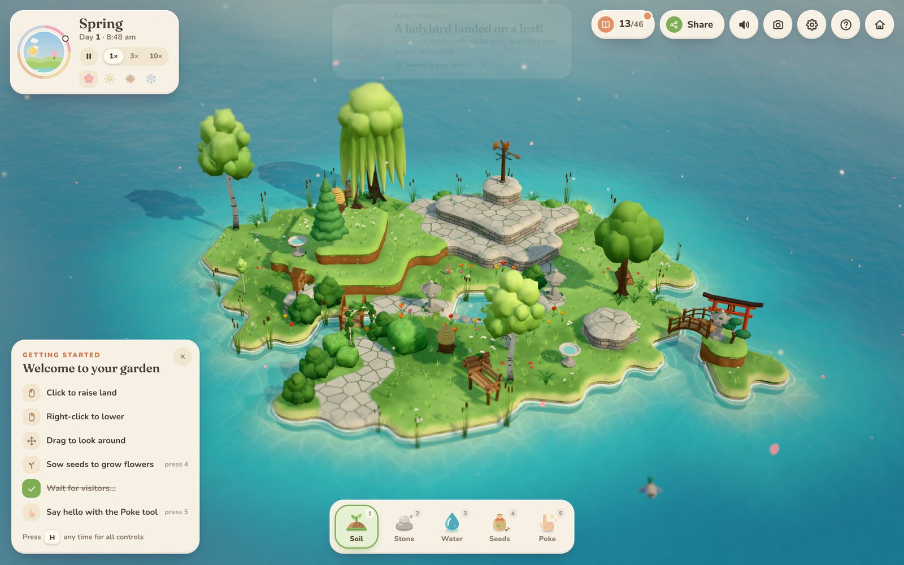
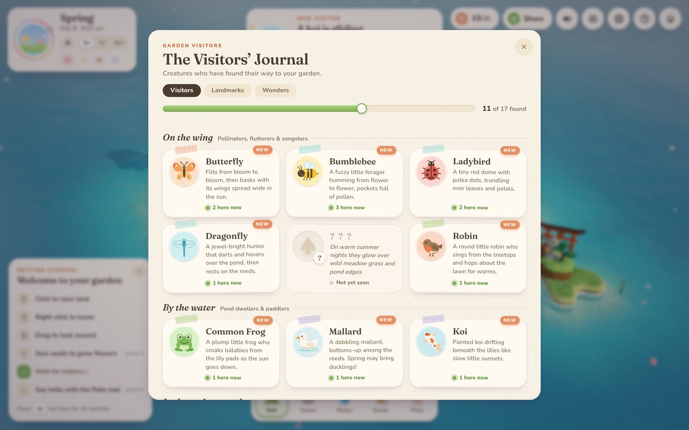

<div align="center">

<picture>
  <source media="(prefers-color-scheme: dark)" srcset="./docs/images/logo-white.png" />
  
</picture>

# Little Island

**一座自己长起来的小岛：捏地形，播种子，然后等访客自己找上门。**

在六边形地块上抬土、挖水、铺石，撒下的种子会自己挑地方扎根 —— 喜欢湿的往水边去，耐旱的留在石缝里。花开的时候蜜蜂和蝴蝶会来，树长高了松鼠会来，夜里有刺猬和萤火虫。你造出什么形状，就长出什么东西，包括那些只在某个季节、某个钟点才现身的东西。

[](#运行)
[](#运行)
[](#技术栈)
[](#26-种植物)
[](#17-位访客)
[](https://island.abobb.com)

</div>

---

## 预览

<table>
<tr>
<td width="50%" align="center"><b>春天的园子</b><br/></td>
<td width="50%" align="center"><b>访客日志</b><br/></td>
</tr>
</table>

> 两张都是实际渲染截图（Chromium 无头 + SwiftShader），不是效果图。左边那座岛是脚本跑的示例花园，不是玩家手捏的。

---

## 玩的是什么

一句话：**地形决定生态，生态决定访客。** 你不动植物，植物自己选地方；你不招动物，动物自己看条件搬进来。

| 环节 | 你怎么做 | 系统怎么回应 |
|---|---|---|
| **造岛** | 左键抬地、右键降地，最多五级台阶；挖出水洼就是池塘，抬到高处就是悬崖 | 地块是六边形网格，抬降后按 80 次松弛迭代重算轮廓，所以边缘是有机的曲线，不是锯齿 |
| **播种** | 选种子点一下，不指定种在哪一块 | 每块地按高度、湿度、海拔折算适配度，种子自己挑最合适的位置；鼠标扫过时会提示这里适合什么（`Tulips, daisies & roses would love it`） |
| **等** | 什么都不用做，时间在走 | 植物按季节开花 / 结果 / 落叶，动物按食物、水源、遮蔽物判断要不要搬来 |
| **发现** | 用 Poke 工具点一下访客或地标 | 会说话（真的有一句台词），第一次接触记进访客日志 |

### 五个工具

| 工具 | 做什么 | 备注 |
|---|---|---|
| **Soil** | 抬土 / 降土 | 左键抬、右键降，可以连续拖拽「画」出地形 |
| **Stone** | 铺石阶、砌石墙 | 石生植物（苔藓、多肉）只认石面 |
| **Water** | 挖水 | 挖穿到水位以下就成了池塘，水底是单独的湖床高度 |
| **Seeds** | 播种 | 分乔木 / 灌木 / 花卉 / 地被 / 水生 / 石生六类 |
| **Poke** | 打招呼 | 点访客、点地标，不改变任何东西，只是打个招呼 |

还有撤销 / 重做（`⇧` 配合撤销键变重做），以及左下角的「Getting started」引导 —— 第一次进来会一步步带你走完抬地、挖水、播种、等访客。

---

## 26 种植物

每种植物有自己的高度、冠幅、开花窗口、结果窗口，以及「愿不愿意给传粉昆虫供蜜」。

| 类别 | 物种 |
|---|---|
| **乔木（6）** | 橡树、白桦、樱花、苹果树、松树、垂柳 |
| **灌木（5）** | 玫瑰、薰衣草、绣球、黄杨绿篱、浆果丛 |
| **花卉（6）** | 郁金香、雏菊、虞美人、向日葵、毛地黄、蓝铃花 |
| **地被（4）** | 草簇、三叶草、蕨类、毒蝇伞 |
| **水生（3）** | 睡莲叶、睡莲、香蒲 |
| **石生（2）** | 苔藓、多肉 |

开花不是布尔值，是一段区间（比如樱花 `0.02–0.2`，雏菊 `0.05–0.62`）。区间可以跨年，樱花的开花窗口就是绕回上一年的 —— 所以「什么时候去看樱花」是个真问题，而不是一个开关。

---

## 17 位访客

访客分四组，日志里也是这么排的。传粉的、喝水的、翻落叶的，还有几位不成群结队、只在特定条件下出现的。

| 分组 | 访客 |
|---|---|
| **On the wing**（传粉者、飞行者、鸣禽） | 蝴蝶、熊蜂、瓢虫、蜻蜓、萤火虫、知更鸟 |
| **By the water**（水边与水面） | 青蛙、绿头鸭、锦鲤 |
| **In the undergrowth**（林下） | 刺猬、红松鼠、兔子、蜗牛 |
| **Spirits of the garden**（光之灵） | 狐灵、鲤龙、晨鸟、光鹿 |

光之灵不按常规条件出现：光鹿要雪夜里的立石，鲤龙要「够大的开阔水面」，狐灵要秋夜的鸟居，晨鸟要夏天日出时绕着灯塔飞。日志的进度条会长期停在 `11 of 17` 这类位置，剩下几位得靠猜。

> 每位访客都有一个「条件」写在日志里，但不是直接告诉你配方 —— 是那种读完能想明白、但第一次读会「哦……原来是这样」的写法。

---

## 地标

你造的地形会长东西。几棵树长在一起且够高，可能长出树屋；石铺地面上挖一个水洞，可能长出喷泉；把地抬到三级以上直插水面，可能长出灯塔。

已知的二十多座：钟楼、篝火、喷泉、凉亭、玻璃温室、温泉、岛上鸟居、风筝、灯塔、瞭望塔、五月柱、秋千、稻草人、雪人、立石、日晷、树屋、水车、风向标、风车、许愿井、园艺棚、鸟浴、蜂箱、鸟屋、长椅、小桥、木栅栏、柴堆、落叶堆、玫瑰拱门、汀步、小划艇、昆虫旅馆……

### 五个节日

节日按各自的季节与钟点开，错过就得等下一圈（Lantern Night 例外 —— 它按夜算，不按季节）。

| 节日 | 什么时候 |
|---|---|
| **Spring Fair** | 春天的白天 |
| **Midsummer Night** | 夏天的深夜 |
| **Harvest Festival** | 秋天的午后与傍晚，黄昏放烟花 |
| **Lantern Night** | 需要三盏灯 |
| **Winter Lights** | 雪夜，灯笼与安静的池塘 |

---

## 时间

一天 180 秒，一个季节两天，一年八个日夜 —— 1× 速度下 24 分钟走完四季。时钟上的太阳会真的走，光照角度、阴影方向、天空颜色、水面反射全部跟着它；点击天空可以跳到下一个时段。

| 时段 / 季节 | 你会看到 |
|---|---|
| 春 · 白天 | 开花，第一批蜜蜂 |
| 夏 · 长日 | 向日葵、蜻蜓，夜里的萤火虫 |
| 秋 · 午后 | 落叶、毒蝇伞、忙着囤粮的松鼠 |
| 冬 · 夜 | 落雪的松树、灯笼、安静的池塘，以及某些只在雪夜出现的东西 |

时间可以倍速，右上角还显示当前气温与天气（有雨、雪、雾）。

---

## 分享

岛是可以连人一起分享的：一键生成岛链接，对方打开就是你这座岛。访客模式下人家改不了你的地形，只能在里面逛。

对方可以给你的岛挂一盏灯笼，每晚亮起来。**三盏灯笼 → Lantern Night。** 这是这套分享机制里唯一的目标，也是唯一必须靠别人才能解锁的节日。

还有照片模式（`P`）：隐藏所有 UI，留一颗小岛，存图的同时把岛链接一起复制好 —— 发图的人顺手就能把岛发出去。

---

## 操作

| 操作 | 键 |
|---|---|
| 旋转视角 / 缩放 | 拖动空白处 / 滚轮或双指 |
| 抬地 / 降地 | 左键 / 右键（长按持续） |
| 暂停 / 继续 | `Space` |
| 照片模式 | `P` |
| 访客日志 | `J` |
| 帮助与全部操作 | `H` |
| 静音 | `M` |
| 主菜单 | `Esc` |
| 撤销 / 重做 | 撤销键 / `⇧` + 撤销键 |

---

## 运行

不需要构建，不需要 `npm install`，`little-habitats/` 就是一个可以直接托管的静态目录：

```sh
git clone <this-repo>
cd little-habitats
python3 -m http.server 8080
# 打开 http://127.0.0.1:8080
```

> 不要双击 `index.html` 用 `file://` 打开 —— ES module 走 `file://` 会被 CORS 挡掉，画面永远停在背景色。必须起一个 HTTP 服务。

需要 **WebGL2**（Chrome / Edge、Safari 15+、Firefox 51+ 之后的版本都行），硬件加速要开着。没有 WebGL2 会直接白屏，没有降级方案。

---

## 部署

线上跑在 **Cloudflare Pages**，项目名 `little-island`，直传静态文件（不接 GitHub、不跑构建），所以发版就是把目录推上去：

```sh
./deploy.sh
```

等价于：

```sh
npx wrangler pages deploy little-habitats \
  --project-name little-island \
  --branch main \
  --commit-dirty=true
```

39 个文件，约 7 秒传完。命令结束会打印一个 `<hash>.little-island-bq9.pages.dev` 的预览地址，`island.abobb.com` 会在几十秒内跟着指到新版本。

| | |
|---|---|
| 生产地址 | `https://island.abobb.com` |
| Pages 默认域名 | `https://little-island-bq9.pages.dev` |
| DNS | `island` → CNAME `little-island-bq9.pages.dev`，橙色云（走 Cloudflare 代理） |

几点实测出来的细节：

- **推的是 `little-habitats/`，不是仓库根**。仓库根的 `README.md` 和 `docs/` 不需要上线。
- `--commit-dirty=true` 是必须的：工作区有未提交改动时 wrangler 会拒绝发版，除非显式放开。
- 没全局装 wrangler 才走 `npx`，第一次会现拉一份；之后有缓存。
- wrangler 的 OAuth 授权里有 `pages:write` 但**没有 DNS 写权限**，所以 `island.abobb.com` 这条 CNAME 只能在 Cloudflare 控制台加，加一次就够，不影响后续发版。

---

## 技术栈

| | |
|---|---|
| 渲染 | three.js（WebGL2）+ `postprocessing`：移轴模糊、Kawase blur、亮度分析，ACES / AgX tone mapping |
| 光照 | 太阳按真实高度角 / 方位角驱动，实时阴影、天空渐变、水面反射跟着走 |
| 地形 | 六边形网格 + 松弛迭代，五级台阶，独立湖床高度 |
| 确定性 | 所有随机数来自带种子的 PRNG（mulberry32 + FNV 哈希）—— 同一个种子必然长出同一座岛 |
| 音频 | 程序化生成，分音乐 / 自然 / 生物三档音量 |
| 字体 | 自托管 woff2：Fraunces（衬线标题）+ Nunito（圆体正文），无外部字体请求 |
| 构建 | Vite，产物带内容指纹 |

### 体积

| | 原始 | gzip |
|---|---:|---:|
| `assets/index-*.js`（主包） | 1.39 MB | 438 KB |
| `assets/three.core-*.js` | 213 KB | 56 KB |
| 20 个按需 chunk（各物种 / 展示场景） | 94 KB | 34 KB |
| **JS 合计** | **1.69 MB** | **528 KB** |
| 字体（11 个 woff2，按 `unicode-range` 分片） | 488 KB | — |

纯 3D + 程序化生成，这个量级基本就是 three.js 本体 + 游戏逻辑的底噪。动物和植物不是预烘焙模型，是按参数现长的几何体 —— 所以除字体外没有任何二进制资源：没有贴图、没有 glTF、没有音频文件（声音是 WebAudio 现合成的振荡器）。

---

## 目录结构

```
.
├── little-habitats/            # 可直接托管的静态站点（构建产物）
│   ├── index.html              # 入口，含 favicon / OG 声明
│   ├── assets/                 # Vite 产物：主包、three.core、按需 chunk
│   │   └── fonts/              # 自托管 woff2 + fonts.css
│   ├── favicon.ico             # 16/32/48/64/128/256 六尺寸
│   ├── favicon.svg             # 内嵌 128px 位图（不描摹，保真脉冲彩色）
│   ├── favicon.png             # 1024×1024，透明底
│   └── apple-touch-icon.png    # 180×180，不透明底（#cfe6ee）
├── docs/
│   ├── images/logo.png         # 仓库标志，Icons8 1600px 原图
│   ├── images/logo-white.png   # 深色模式版：深蓝笔画转白，淡绿填充保留
│   ├── preview-garden.jpg
│   └── preview-journal.jpg
└── README.md
```

`index.html` 里的四条图标声明各自有分工：`.ico` 供老浏览器与 Windows 缩略图，`.svg` 给现代浏览器（同源矢量缩放最锐），`.png` 给不认 SVG 的场合，`apple-touch-icon` 给 iOS 主屏（iOS 不会自己加底，所以那一张是实底并内缩了留白）。

深色模式标志不是简单反色 —— 只把深蓝笔画换成白色，淡绿填充仍是原来的绿。整张压成纯白剪影的话，叶脉和叶片就糊成一块，失去「两层」的结构。

---

## 说明

- **仓库里只有构建产物**，游戏逻辑的源码不在这里。`assets/` 下的文件带内容指纹，是 Vite 打包后的输出，不可直接编辑。
- 站内文案是英文的，游戏内的标题页与主菜单仍然写着 `Little Habitats`；仓库与项目名统一用 **Little Island**。
- 没有针对移动端做像素级适配：触屏能玩（拖动旋转、双指缩放），但小屏上的面板排版不保证。

---

## 致谢

**图标**：[「月桂叶」图标](https://igoutu.cn/icon/JxV3E8wmRjx0/%E6%9C%88%E6%A1%82%E5%8F%B6)，来自 [Icons8](https://icons8.com)（中文站 [igoutu.cn](https://igoutu.cn)），风格 Pulse / 脉冲彩色，作者 Icons8 团队。按 Icons8 免费许可（Free / Linkware）使用，需保留指向 Icons8 的链接。

从 1600×1600 PNG 出发做了三件事：

1. 原图直接作为仓库标志存为 `docs/images/logo.png`；
2. 生成深色模式版 `docs/images/logo-white.png`，只换笔画颜色；
3. 网页图标按「裁到笔画外框 + 留 6% 白边」重新取景 —— 原图四周留白偏多，16px 下笔画会瘦掉一圈。

**字体**：Fraunces 与 Nunito，均为 SIL Open Font License，自托管。
